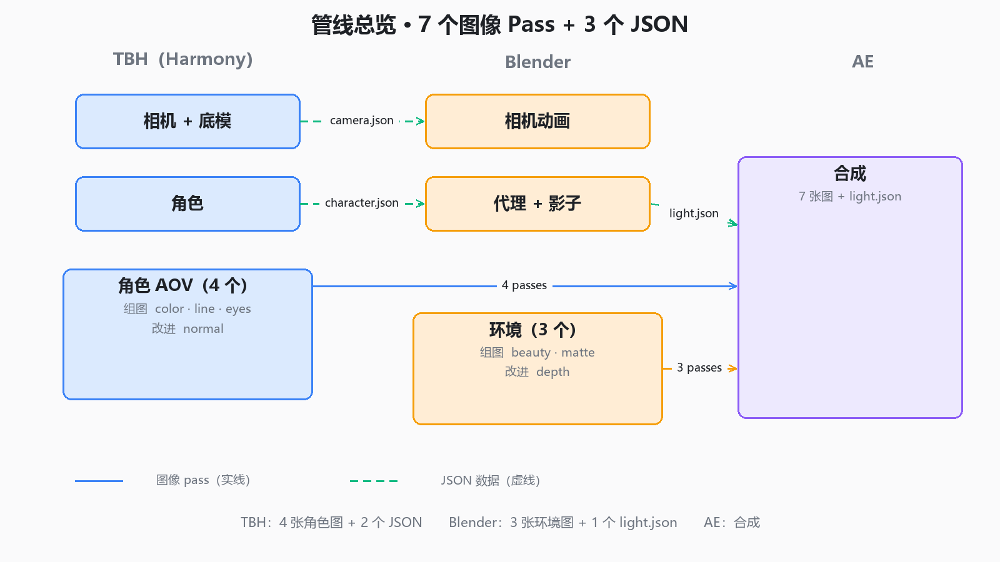

# TBH ↔ Blender Hybrid 2D/3D Pipeline

> Author a camera in **Toon Boom Harmony**, export it to **Blender**, render the 3D
> environment, and composite the 2D character over it in **After Effects** — with the
> camera matching to the pixel.

2D 角色 + 3D 环境的混合管线：**相机在 Harmony 里定，3D 环境在 Blender 里渲，最后在 AE 里合成**。

---

## The problem 解决的问题

Hand-drawn 2D characters need to live inside a 3D world: perspective, camera moves,
depth of field, contact shadows. But animation is authored in a 2D tool, so the camera
has to be authored there too.

**手绘角色要放进 3D 世界**（透视、运镜、景深、接触阴影），但动画是在 2D 软件里做的——
所以相机也必须在 2D 软件里定。

This project bridges that: the Harmony camera is exported as matrices, converted into a
Blender camera, and the 2D character is carried into Blender as a hidden proxy so that
lighting and shadows line up.

---

## Result 效果

| | |
|---|---|
| Camera accuracy | **0–1 px** over 10 frames, 5 conditions (move / translate / uniform scale / 3-axis rotation / animated FOV) |
| Character position | **≤ 2.4 px** |
| Verified on | Harmony 25 Premium 25.0.1 · Blender 5.2 LTS · AE 2025 |



---

## The formula 核心公式

```
M_rel = M_h⁻¹ · M_c                  # both from Harmony (OGL space)
R, t, s = decompose(M_rel)           # drop s
Blender camera = rotX(90°) @ [ R | t × 4.5 ]
lens = 18 / ( tan(fov / 2) × aspect )  # fov = vertical FOV
```

- `4.5` is the OGL → scene scale constant (confirmed across projects and camera positions)
- `fov` is the **vertical** field of view (Harmony "Vertical Fit")
- the character proxy uses `rotX(90°) @ [ R_char | t_char × 4.5 ]`

Full derivation and test records: [`docs/TBH25-Blender-摄像机同步-完整技术文档.md`](docs/TBH25-Blender-摄像机同步-完整技术文档.md)

---

## Data 交换的数据

| File | From | To | Contents |
|---|---|---|---|
| `camera.json` | Harmony | Blender | per-frame camera + model matrices, FOV, fps, resolution |
| `character.json` | Harmony | Blender | per-frame character + model matrices |
| `light.json` | Blender | After Effects | per-frame light direction / position / colour / energy, character depth |

Examples: [`samples/`](samples/)

---

## Passes 出片分两层

**Beauty（组图）** — composited directly:

- `env_beauty` (Blender Combined, with contact shadow baked in)
- `char_color`, `char_line`, `char_eyes` (Harmony)

**Utility（改进）** — used as parameters, never colour-managed:

- `env_depth`, `env_matte` (Blender)
- `char_normal` (Harmony)
- `light.json`

See [`docs/管线总览.md`](docs/管线总览.md) and [`docs/AE合成清单.md`](docs/AE合成清单.md).

---

## Docs 文档

| Doc | What |
|---|---|
| [管线总览](docs/管线总览.md) | one-page overview with diagram |
| [使用说明](docs/使用说明.md) | step-by-step operation manual |
| [Harmony出片设置](docs/Harmony出片设置.md) | character AOV export |
| [Blender出片设置](docs/Blender出片设置.md) | environment passes + EXR output |
| [AE合成清单](docs/AE合成清单.md) | compositing checklist |
| [色彩管理](docs/色彩管理.md) | linear workflow across all three apps |
| [相机同步-加固清单](docs/相机同步-加固清单.md) | edge cases and test records |
| [完整技术文档](docs/TBH25-Blender-摄像机同步-完整技术文档.md) | full derivation and verification |

---

## What is **not** included 不包含什么

The tooling itself (Harmony export scripts, Blender add-ons, AE helper script) is
**not public**. This repository documents the method, the data format and the results.

工具本身（Harmony 导出脚本、Blender 插件、AE 辅助脚本）**不公开**。
本仓库公开的是方法、数据格式和验证结果。

---

## Status 状态

- ✅ Camera sync — verified
- ✅ Character proxy + contact shadow
- ✅ Light data export
- ⚠️ Full AOV pipeline — in progress (depth / matte / relight)
- ⚠️ 1-minute test film — not yet

---

## License

Documentation: [CC BY-NC 4.0](LICENSE) — 非商业使用，署名。
The method described may be implemented freely; the documents may not be sold.
