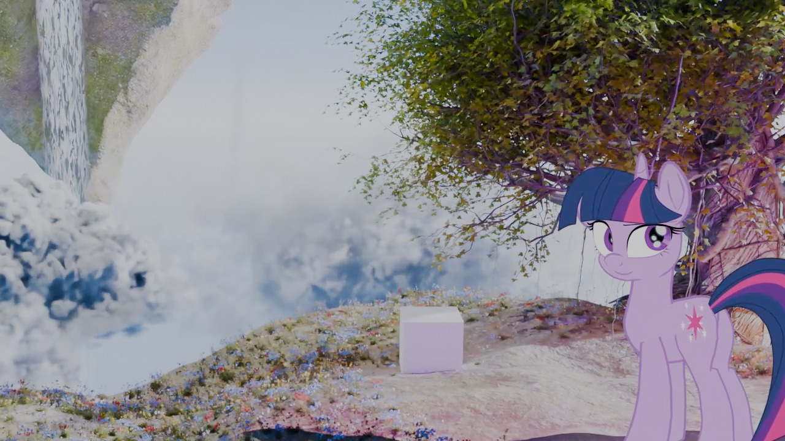

# TBH ↔ Blender Hybrid 2D/3D Pipeline

> Author a camera in **Toon Boom Harmony**, export it to **Blender**, render the 3D
> environment, and composite the 2D character over it in **After Effects** — with the
> camera matching to the pixel.

2D 角色 + 3D 环境的混合管线：**相机在 Harmony 里定，3D 环境在 Blender 里渲，最后在 AE 里合成**。

*测试镜头：角色在 Harmony 渲染，环境在 Blender 渲染，用本管线对齐后合成。*

---

## Test shot 测试镜头

一段 6 秒的测试：相机在 Harmony 里做动画，导出到 Blender 驱动 3D 环境，
角色在 AE 里合成上去。

▶ [看测试片段（samples/Comp.mp4）](samples/Comp.mp4)

| | |
|---|---|
| 时长 | 6 秒 / 144 帧 @ 24fps |
| 角色 | Harmony 渲染（EXR，带 alpha） |
| 环境 | Blender 渲染（EEVEE） |
| 合成 | After Effects |

> 这是流程验证片，不是成品：还没有 AOV 分层、没有重打光、没有调色。

---

## The problem 解决的问题

Hand-drawn 2D characters need to live inside a 3D world: perspective, camera moves,
depth of field, contact shadows. But the animation is authored in a 2D tool, so the
camera has to be authored there too.

**手绘角色要放进 3D 世界**（透视、运镜、景深、接触阴影），但动画是在 2D 软件里做的——
所以相机也必须在 2D 软件里定。

This project bridges the two: the Harmony camera is exported as data, reconstructed in
Blender, and the 2D character is carried along as a hidden proxy so that lighting,
shadows and depth line up with the drawing.

---

## Result 结果

| | |
|---|---|
| Camera match | **0–1 px** over 10 frames, 5 conditions (dolly / translate / uniform scale / 3-axis rotation / animated FOV) |
| Character match | **≤ 2.4 px** |
| Verified on | Harmony 25 Premium · Blender 5.2 LTS · After Effects 2025 |

---

## What flows between the apps 交换的数据

| File | From | To | Contents |
|---|---|---|---|
| `camera.json` | Harmony | Blender | per-frame camera + model transforms, FOV, fps, resolution |
| `character.json` | Harmony | Blender | per-frame character + model transforms |
| `light.json` | Blender | After Effects | per-frame light direction / position / colour / energy, character depth |

Format examples: [`samples/`](samples/)

**How the transforms are converted is not documented here** (see below).

---

## Passes 出片分两层

**Beauty（组图）** — composited directly:

- `env_beauty` — Blender Combined, contact shadow baked in
- `char_color` / `char_line` / `char_eyes` — Harmony

**Utility（改进）** — used as parameters, never colour-managed:

- `env_depth`, `env_matte` — Blender
- `char_normal` — Harmony
- `light.json`

More: [`docs/管线总览.md`](docs/管线总览.md) · [`docs/AE合成清单.md`](docs/AE合成清单.md)

---

## Docs 文档

| Doc | What |
|---|---|
| [管线总览](docs/管线总览.md) | one-page overview with diagram |
| [Harmony出片设置](docs/Harmony出片设置.md) | character AOV export |
| [Blender出片设置](docs/Blender出片设置.md) | environment passes + EXR output |
| [AE合成清单](docs/AE合成清单.md) | compositing checklist |
| [色彩管理](docs/色彩管理.md) | linear workflow across all three apps |
| [合成篇](docs/TBH-Blender-合成篇-完整技术文档.md) | how the two layers are merged |

---

## What is **not** included 不包含什么

- **The tooling** — Harmony export scripts, Blender add-ons, AE helper. Not public.
- **The camera conversion method** — how Harmony transforms become a Blender camera.
  This is the core of the tool and is not documented in this repository.

工具本身、以及**相机换算的方法**，都不在本仓库里。
这里公开的是：管线结构、数据格式、出片与合成流程、验证结果。

---

## Status 状态

- ✅ Camera match — verified on a real scene
- ✅ Character proxy + contact shadow
- ✅ Light data export
- ⚠️ Full AOV pipeline (depth / matte / relight) — in progress
- ⚠️ 1-minute test film — not yet

---

## License

Documentation: [CC BY-NC 4.0](LICENSE) — attribution, non-commercial.
