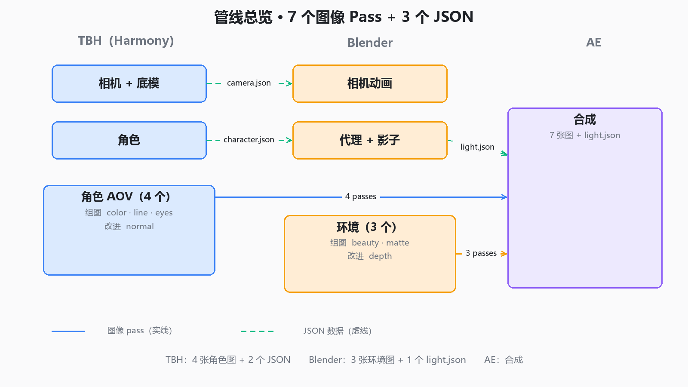

# 管线总览（一页）



> 7 个图像 Pass + 3 个 JSON。实线 = 图像，虚线 = 数据。

---

## 〇、两类 Pass：组图 vs 改进

|  | **组图（组成画面）** | **改进（驱动效果）** |
|---|---|---|
| 作用 | 直接拼成画面 | 在成图上做效果 |
| 怎么用 | 叠上去、混合 | **不叠**，当参数/遮罩 |
| 少了会怎样 | 画面缺一块 | 画面还在，只是没效果 |
| 例子 | beauty、角色、描边、遮挡 | Z depth 做景深、normal 做受光 |

### 两个维度并排看

|  | **组图** | **改进** |
|---|---|---|
| **图像** | `env_beauty`、`char_color`、`char_line`、`char_eyes` | — |
| **数据** | `env_matte` | `env_depth`、`char_normal`、`light.json` |

**横着是用途，竖着是格式。**

### 技术上的连带差别

| | 组图（图像） | 改进（数据） |
|---|---|---|
| 色彩管理 | 要 | **绝对不能** |
| 压缩 | DWAA 可以 | **必须 ZIP 无损** |
| 滤镜（Kuwahara 等） | 可以 | **绝对不能** |

**数据通道一旦被当成图片处理（gamma、有损压缩、滤镜），就废了。**

---

## 一、TBH 出什么（4 图 + 2 数据）

| 产出 | 用途 | 格式 | 给谁 |
|---|---|---|---|
| `char_color` | **组图** | 图像 | AE |
| `char_line` | **组图** | 图像 | AE |
| `char_eyes` | **组图** | 图像 | AE |
| `char_normal` | **改进** | 数据 | AE（重打光） |
| `camera.json` | 数据 | — | Blender |
| `character.json` | 数据 | — | Blender |

## 二、Blender 出什么（3 图 + 1 数据）

| 产出 | 用途 | 格式 | 给谁 |
|---|---|---|---|
| `env_beauty` | **组图** | 图像 | AE（**角色影子已烤在里面**，带 Kuwahara） |
| `env_depth` | **改进** | 数据 | AE（雾、景深、排序） |
| `env_matte` | **组图** | 数据 | AE（前景遮挡，决定谁盖住谁） |
| `light.json` | **改进** | 数据 | AE（**所有灯**的方向/位置/颜色/强度 + 角色深度） |

**进 AE 的：5 个组图 + 2 个改进（图像），外加 1 个 `light.json`（改进数据）。**

## 三、AE 拿什么合成

**7 张图（5 组图 + 2 改进）+ 1 个 JSON**（`light.json`）。

`camera.json` 和 `character.json` **不进 AE**，它们只服务于 Blender。

---

## 四、AE 层序（从下往上）

```
⑧ 调色 / 颗粒 / 暗角
⑦ 大气（雾、景深）        ← env_depth + light.json 的 depth
⑥ 前景遮挡                ← env_matte
⑤ 眼睛发光（Add + Glow）  ← char_eyes
④ 描边                    ← char_line
③ 角色（重打光）          ← char_color + char_normal
                            光方向 ← light.json 的 dir
② 角色影子                 ← 已烤在 env_beauty 里
① 环境                    ← env_beauty
```

---

## 五、制作顺序（重要）

```
① TBH 渲角色 AOV（4 个 pass）
        ↓
② Blender 导入 camera.json + character.json
        指定角色图 → 影子平面
        ↓
③ Blender 导出 light.json（File > Export > Light Data (.json)）
        ↓
④ Blender 渲环境（3 个 pass，带影子）
        ↓
⑤ AE 合成
```

**为什么角色要先渲**：影子平面要贴角色的图，才知道影子长什么样。
**为什么光最后导**：要读角色代理的位置。

---

## 六、每个文件的「生产地」

| 文件 | 生成工具 | 生成方式 |
|---|---|---|
| `camera.json` | Harmony | `TB_ExportMatrix.js` |
| `character.json` | Harmony | `TB_ExportCharacter.js` |
| 4 个 char pass | Harmony | Write 节点 + Render Write Nodes |
| `light.json` | Blender | **单独导出**（`File > Export > Light Data (.json)`） |
| 3 个 env pass | Blender | Compositor 的 File Output |

---

## 七、还不确定的

- `char_normal` 的具体格式（等绑定做完再验）；
- AE 端的光驱动脚本（等 AE 里确认 Normality 参数名）；
- 交付编码（H.264 最可能）。
